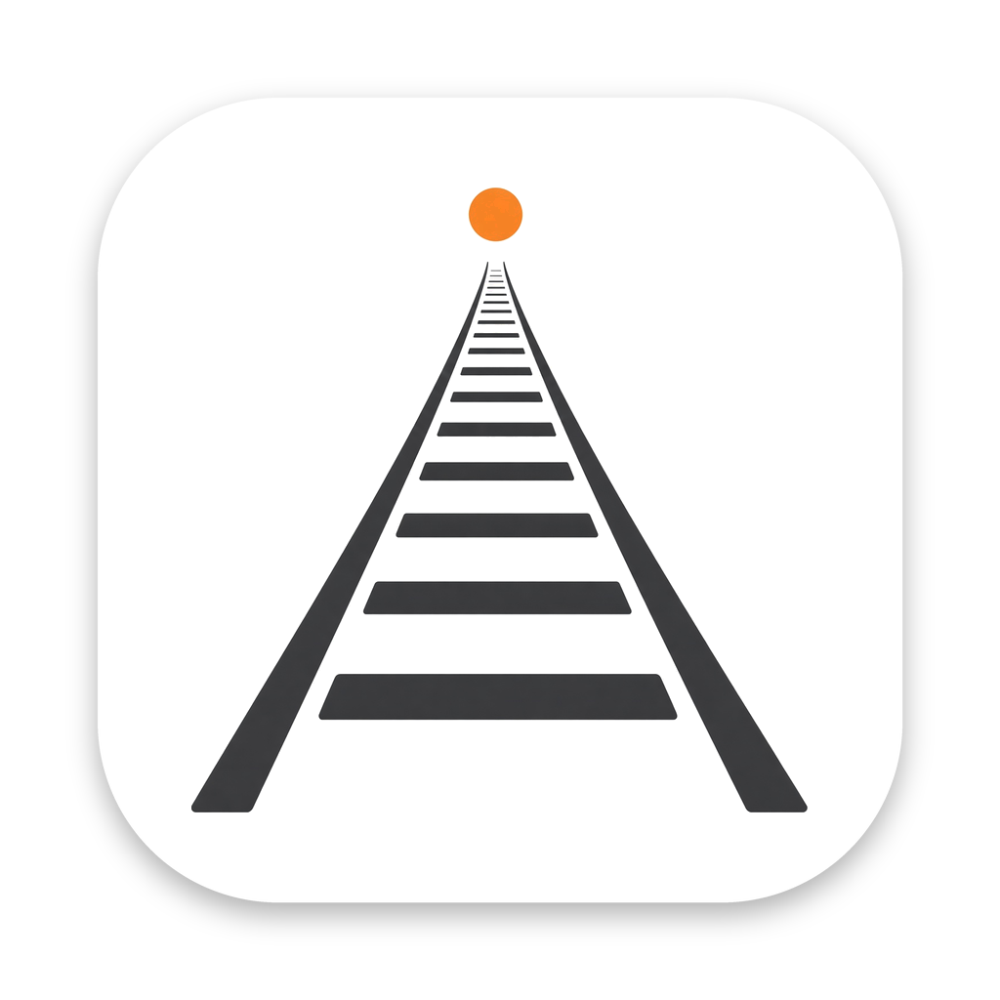
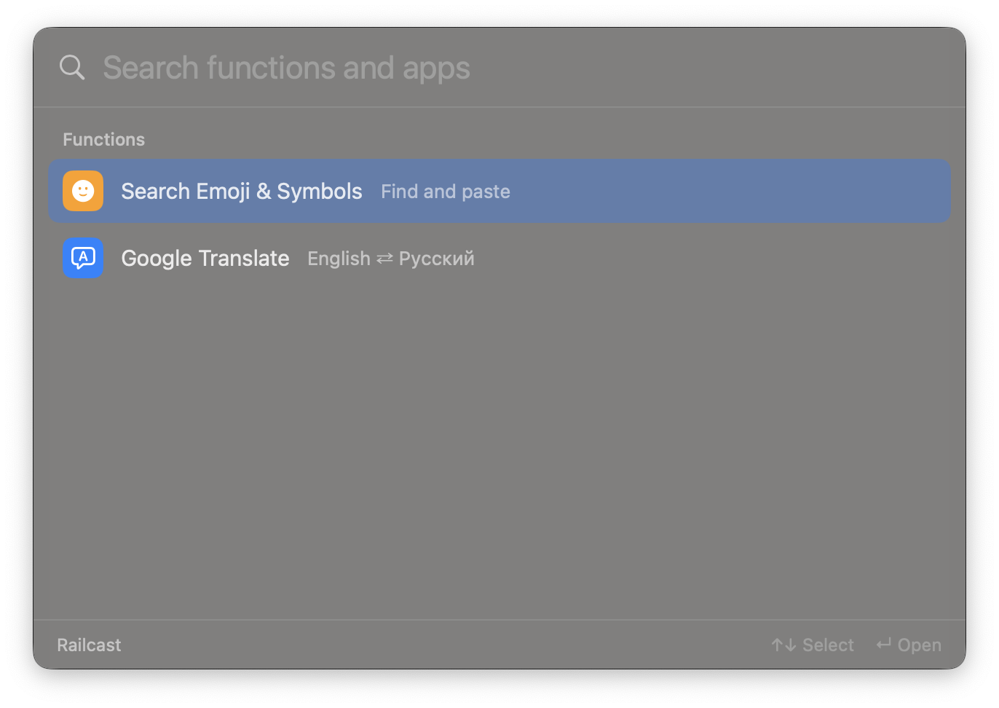
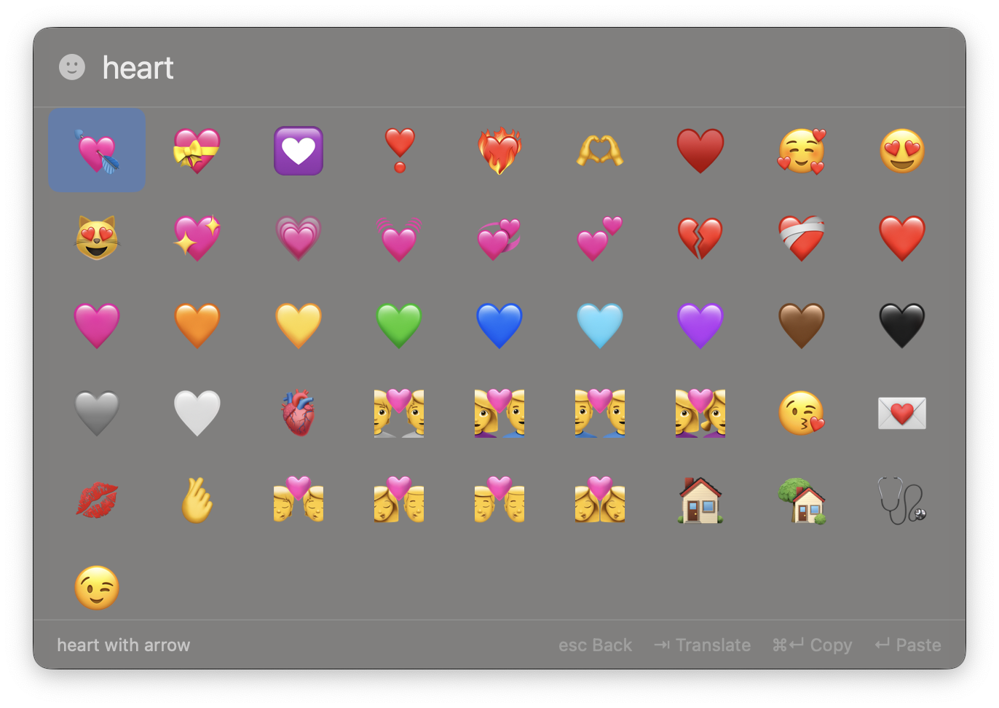
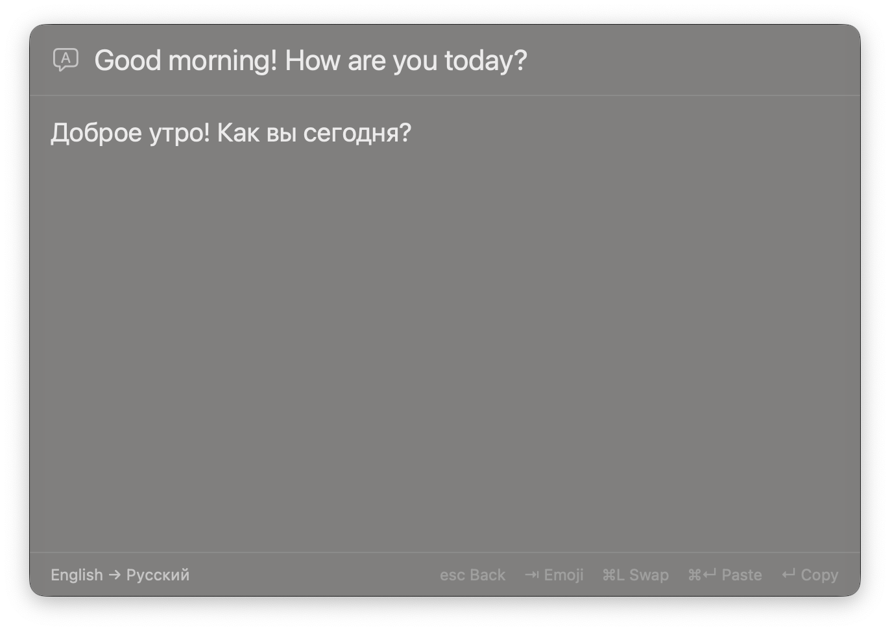

<p align="center"></p>

# Railcast

A minimal macOS launcher: quick app launch, emoji and symbol search, and Google Translate.

Requires macOS 14 or later.

<p align="center"></p>

### Emoji and symbol search

<p align="center"></p>

### Google Translate

<p align="center"></p>

## Install

Download the DMG from Releases and drag Railcast to Applications. The app is not notarized, so remove the quarantine flag before the first launch:

```sh
xattr -dr com.apple.quarantine /Applications/Railcast.app
```

Pasting into other apps needs the Accessibility permission, which macOS requests on first use.

## Usage

Press `⌥Space` to open Railcast. Option-Space must not be taken by another app.

| Key | Action |
|---|---|
| `↑` `↓` `↵` | Choose and open a function or app |
| `⇥` | Switch between emoji and translate |
| `↵` | Paste the emoji, or copy the translation |
| `⌘↵` | Copy the emoji, or paste the translation |
| `⌘L` | Swap the translation direction |
| `esc` | Go back, then close |

To hide the menu bar icon, use its menu or search for `hide` in Railcast. While it is hidden, the start screen has a row to show it again, and search for `quit` closes the app.

Translation uses Google's free, unofficial endpoint, which needs no API key but has no guarantees.

## Build

```sh
swift test
Scripts/build-app.sh   # build/Railcast.app
Scripts/build-dmg.sh   # build/dmg/Railcast-<version>-universal.dmg
```

## Release

Set the version in `Resources/Info.plist`, add a section to `CHANGELOG.md`, then push a `vX.Y.Z` tag. GitHub Actions builds the DMG and publishes the release.
